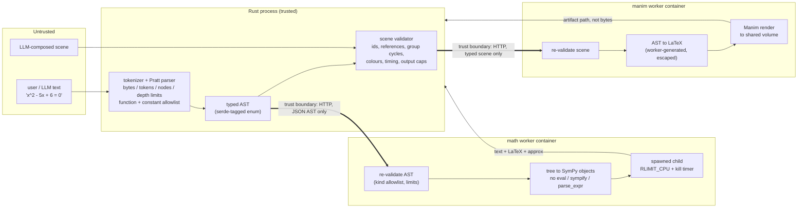

# safe-math

Symbolic math and Manim animation for untrusted input, with no `eval` anywhere. Rust parses the input under hard limits into a typed AST. Isolated Python workers then re-validate that tree and interpret it. They never execute it.


*Rendered by the Manim worker in this repo from the scene in [`crates/manim/examples/render.rs`](crates/manim/examples/render.rs). Every equation in it was sent as an AST, not as LaTeX or Python.*

## Why this exists

The usual way to "do math in Python" for a user is `sympy.sympify(user_string)`. That is `eval` with extra steps. The same applies to the usual way to make an animation, which is to have a model write a Manim script and run it. This code was extracted from the computation layer of a production AI learning workspace. There, both the expressions and the animation scenes come from students and from LLMs, and neither can be trusted to be code. It needed a CAS and a renderer that keep working when the input is hostile, and that fail closed when it is merely huge.

## The security story

There are three layers. Each one assumes the layer before it can be bypassed.

1. **Parse in Rust, under limits.** A hand-written tokenizer and Pratt parser ([`crates/math/src/parser.rs`](crates/math/src/parser.rs)) accept a deliberately small language: numbers, symbols, `+ - * / ^ !`, and an allowlist of 20 functions and 4 constants. Limits apply before anything is built: 16 KiB of input, 4,096 tokens, 2,048 AST nodes, depth 128 (checked during recursion, not after), 64 variables, 256-character numeric literals, and 64-byte identifiers. Identifiers with a leading underscore or a dunder are rejected at the lexer, so `__import__` never becomes a symbol.
2. **Send a typed AST, never a string.** The wire format is a tagged JSON tree (`{"kind":"power","base":…,"exponent":…}`). Every free-text field in a request (expression, bound, substitution, limit point, variable name) is parsed into that tree before the HTTP call. A raw string has no path to the worker.
3. **The worker re-validates and interprets.** [`workers/math/worker.py`](workers/math/worker.py) checks every node again: the kind allowlist, literal regexes, symbol-name rules, node and depth limits. It then builds SymPy objects by walking the tree with `sp.Add`, `sp.Mul`, and a function table. It never calls `eval`, `exec`, `sympify`, or `parse_expr`. Each operation runs in a spawned child process with `RLIMIT_CPU` and a wall-clock kill timer, and concurrency is capped by a semaphore that returns 429 rather than queueing without bound. The Manim worker follows the same pattern. Scenes are a typed object tree, LaTeX is generated *by the worker* from the math AST ([`workers/manim/latex.py`](workers/manim/latex.py)), and plotted curves are sampled by a small tree interpreter instead of a compiled lambda.



### Design decisions and tradeoffs

- **A small language beats a sandbox.** Sandboxing `sympify` (seccomp, AST filtering of Python source) is an arms race. A grammar with 10 node kinds is something you can read in one sitting. The cost is expressiveness: there are no matrices, sums, piecewise functions, or user-defined functions. Adding one means one enum variant in Rust and one branch in each worker.
- **N-ary `add` / `multiply`.** `1+2+3+…` builds one node with many children instead of a left-deep tree, which keeps node and depth accounting meaningful for ordinary polynomials. It also means `a - b` becomes `add[a, negate(b)]`. The LaTeX writer turns that back into `a - b`.
- **Validate twice, on purpose.** The worker port can be reached without going through Rust. The worker therefore never assumes the client did its job, and the gated integration test sends it a hand-written `{"kind": "python"}` node to prove it.
- **Verification is honest about uncertainty.** `verify` returns `proven`, `disproven` (with a counterexample when it finds one), or `inconclusive`. For single-variable identities it compares singularities before simplifying, so `(x^2-1)/(x-1) ≡ x+1` is **disproven at x = 1** instead of being "simplified" into a false identity.
- **Infinite answers are not truncated.** `sin(x) = 0` over the reals returns the `ImageSet` as a `solutionSet`. It does not return the first few roots, and it does not return an empty list.
- **Renders go to a volume, not to the response.** The worker returns a relative path. A finished render survives a failed upload, and a multi-megabyte body is never a copy of a file that already exists.
- **Manim runs in its own container.** It needs TeX, Cairo, Pango, and ffmpeg (the image is about 3 GB) and is CPU-bound for seconds to minutes. Running it in a worker shared with fast requests would stall them, so it gets concurrency 1 and a queue timeout.

## Workspace

| Crate / dir | What it does |
|---|---|
| `crates/engine-core` | Shared `Engine` trait, metadata, health, and a typed `EngineError` (kind, stable code, retryable flag). |
| `crates/math` | Parser, AST, request protocol, and `SympyMathEngine` HTTP client. Operations: calculate, simplify (smart/factor/expand/cancel/together/trig), differentiate, integrate (definite and indefinite), limit (left/right/both), solve (complex/real/integer, systems), and verify. |
| `crates/graphing` | Plain-text expressions to validated, renderer-neutral 2D/3D plot specs (function, parametric, polar, implicit, scatter, surface). Rejects symbols a series did not declare, and colours that are not hex or theme tokens (`url(javascript:…)` included). |
| `crates/manim` | Typed scene protocol, a validator (references, group cycles, timing, output caps), and the `RemoteManimEngine` client. |
| `crates/selector` | Rule-based visualization picker. It scores 21 formats against intent, data shape, and experience requirements, and returns the winner with its reasons, tradeoffs, and alternatives. |
| `workers/math` | SymPy worker (stdlib HTTP server, hash-pinned deps). |
| `workers/manim` | Manim worker: scene builder, LaTeX writer, theme palette, token auth. |

## Quick start

You need Rust 1.90 or newer and Docker.

```bash
# both workers (first build pulls manimcommunity/manim, about 900 MB compressed)
docker compose up -d --build --wait

# solve through the SymPy worker
cargo run -p engine-math --example solve -- "x^2 - 5x + 6 = 0"
```

```text
parsed:    x^2 + -(5 * x) + 6 = 0
size:      10 nodes, depth 4, symbols {"x"}
solution 1: x = 2   (LaTeX: x = 2)
solution 2: x = 3   (LaTeX: x = 3)
backend:   sympy-1.14.0 in 48 ms
```

A few more inputs to try:

```bash
cargo run -p engine-math --example solve -- --ast "2x + 3(x - 1) = 7"   # print the wire AST
cargo run -p engine-math --example solve -- "x^2 + 1 = 0"               # x = -I, x = I
cargo run -p engine-math --example solve -- --real "sin(x) = 0"         # infinite solution set
cargo run -p engine-math --example solve -- "__import__('os')"          # refused in Rust, never sent
cargo run -p engine-math --example smoke                                # calculate/simplify/diff/solve/verify
```

Render the animation at the top of this page:

```bash
cargo run -p engine-manim --example render -- mp4      # or: gif, webm
# prints e.g. renders/<job-id>/scene.mp4 - copy it out of the volume:
docker compose cp manim:/media/renders/<job-id>/scene.mp4 ./scene.mp4
```

The two crates that need no worker:

```bash
cargo run -p engine-graphing --example plot_spec -- "sin(x) / x"   # JSON plot spec
cargo run -p engine-graphing --example plot_spec -- "x + secret"   # refused: undeclared symbol
cargo run -p engine-selector --example choose                      # format choice with reasons
```

The examples honour `MATH_ENDPOINT`, `MANIM_ENDPOINT`, and `MANIM_TOKEN`. Set `MANIM_TOKEN` before `docker compose up` to make the renderer require `Authorization: Bearer …`. The comparison runs in constant time, and `/health` stays open.

## Tests

```bash
cargo test --workspace                       # 30 unit tests + 5 gated round trips that skip, no containers needed

cd workers/math  && pip install -r requirements-dev.txt && python -m pytest -q    # 5 tests
cd workers/manim && pip install -r requirements.txt     && python -m pytest -q    # 51 tests (Manim stubbed)
```

The gated tests talk to real workers. Without their environment variable they skip themselves:

```bash
docker compose up -d --wait
WORKER_TESTS=1 cargo test --workspace --test worker_roundtrip        # 5 round trips

# real in-process renders (needs manim==0.19.0 plus Cairo, Pango, ffmpeg, LaTeX, dvisvgm)
cd workers/manim && MANIM_RENDER_TESTS=1 python -m pytest -q test_render.py
```

`test_render.py` has to run on its own. Other test modules install a Manim stub at import time, and the render test skips itself when it detects the stub.

What the tests prove:

- **Parser:** precedence (`-x^2` is `-(x^2)`, `^` is right-associative), implicit multiplication and Unicode operators, factorial postfix, rejection of multiple `=` and of private names, and that a 140-deep nesting is refused *before* reaching the worker.
- **Client preparation:** every raw bound and substitution becomes an AST, variables are inferred deterministically, and bad precision, derivative order, or variable names stop before HTTP.
- **Wire contract:** responses captured from the worker decode correctly, including the infinite `solutionSet` and verification counterexamples. The manim protocol tests pin the exact field spellings the Python side reads.
- **Workers:** the SymPy worker differentiates, solves, proves `sin² = 1 − cos²`, disproves a false derivative, keeps the excluded point of a cancelled fraction, and refuses unknown AST kinds. The Manim worker re-validates scenes, refuses unknown object kinds instead of rendering a blank video, checks bearer auth, emits correctly parenthesised LaTeX, and evaluates plot trees without `eval`.
- **Round trips:** the quadratic solved through the container, the infinite set preserved, the cancelled fraction disproven at `x = 1`, a hand-written `{"kind":"python"}` payload rejected with 400, and a real MP4 rendered to the volume.

## What was left out

The production system wraps these engines in an LLM tool layer, a job queue, object-storage upload of finished renders, per-workspace auth, and a Remotion engine for narrated video. The selector still names `RemotionEngine` as a routing target, but that engine is not included here. Those parts depend on the host product's schema and infrastructure, so this repo stops at the engine boundary: crates that validate and talk HTTP, and two workers you can run with one `docker compose up`.

## Credits

- [SymPy](https://www.sympy.org/) (BSD-3-Clause) does all the symbolic computation in the math worker.
- [Manim Community](https://www.manim.community/) (MIT) renders the animations. The worker image builds on `manimcommunity/manim`.

Licensed under the [MIT License](LICENSE).
